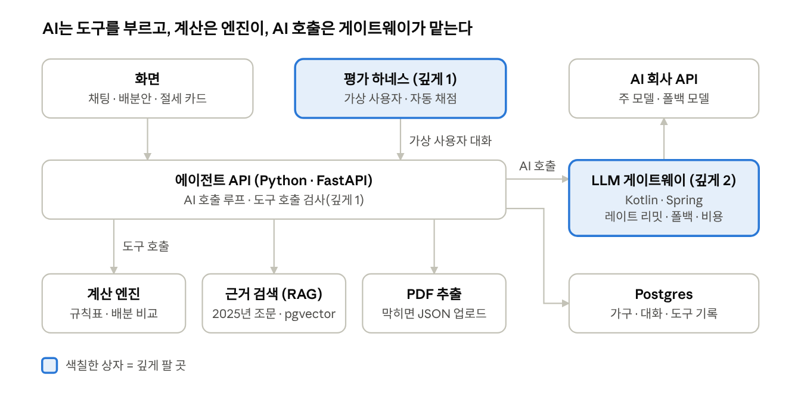

# taxsplit 설계 문서

| 항목 | 내용 |
| --- | --- |
| 문서 번호 | TS-DES-001 |
| 버전 | v0.2 (초안) |
| 상태 | 검토 중 |
| 작성자 | 서아진 |
| 작성일 | 2026-11-11 |
| 관련 문서 | TS-PRD-001 PRD, TS-EVAL-001 평가 계획, docs/adr/0001~0007 |

## 1. 요약

AI는 대화로 정보를 모으고 도구를 부르는 역할만 하고, 세금 계산·배분 비교·시뮬레이션은 전부 Python 계산 엔진이 맡아요. 모든 AI 호출은 3주차부터 Kotlin 게이트웨이를 거쳐요. 용어는 PRD 부록의 용어 풀이를 따라요.

## 2. 전체 구조

화면과 평가 하네스는 같은 에이전트 API를 부르고, 에이전트의 AI 호출은 전부 게이트웨이를 거쳐 AI 회사로 가요. 색칠한 상자는 깊게 파는 곳이에요.

## 3. 구성 요소

| 구성 요소 | 언어 | 하는 일 | 안 하면 무엇이 깨지나 |
| --- | --- | --- | --- |
| 화면 | React | 채팅(SSE), 배분안 비교, 근거 조문, 절세 카드 | 발표에서 완성된 서비스로 안 보임 |
| 에이전트 API | Python (FastAPI) | 대화 관리, AI 호출 루프, 도구 실행 | - |
| 도구 호출 검사기 | Python | AI가 넘긴 값이 형식에 맞는지 검사, 실패 이유를 AI에게 돌려주고 재시도, 최대 횟수 제한, "요건 확인 전 계산 금지" | AI가 "어머니 연소득: 약 300만" 같은 값을 넘겨도 그대로 계산됨 |
| 계산 엔진 | Python | 결정세액 계산, 가능한 배분 전부 비교, 중복공제 검사, 절세 행동 시뮬레이션. 결과마다 쓴 규칙 ID를 남김 | LLM이 계산하면 숫자가 틀려도 모름 |
| 규칙표 | 데이터 파일 | 연도별 공제율·한도·문턱과 근거 조문 | 연도가 바뀌면 코드를 고쳐야 함 |
| PDF 추출 | Python | 간소화 PDF에서 공제 항목을 정해진 형식으로 뽑고 검사. 추출 방법은 같은 입출력 형식 뒤에 두어 갈아끼울 수 있게 함(v1은 하나, 시나리오③에서 pdfplumber·Docling·Upstage·Claude 비교) | 막히면 JSON 업로드로 대체 |
| 근거 검색 (RAG) | Python + pgvector | 2025년 귀속 조문 검색, 근거 표시 | "왜 아내 쪽이 유리한가"에 답이 없음 |
| LLM 게이트웨이 | Kotlin (Spring) | AI 호출 중계·스트리밍, 호출별 비용 기록, 레이트 리밋(Redis), 재시도·타임아웃·서킷브레이커·폴백(Resilience4j) | AI 회사 서버가 느려지거나 거절하면 대화가 멈춤 |
| 평가 하네스 | Python | 가상 사용자와 에이전트를 대화시켜 자동 채점, 결과 JSON 저장 | 프롬프트를 고쳐도 좋아졌는지 알 수 없음 |
| DB | Postgres | 가구, 대화, 도구 호출 기록, AI 호출별 토큰·비용 | 대화 이어가기와 틀린 이유 분석이 안 됨 |

레포 taxsplit(AJin1068/taxsplit)에 `agent/`(Python), `web/`(React, PR 14a에서 추가), `gateway/`(Kotlin, 11/23부터), 루트 `eval/`(채점 코드·정답)을 두는 구조로 확정됐고 PR #5로 구현됐어요. Python 쪽 AI 호출 주소(base_url)는 설정값이라, 게이트웨이가 생기면 주소만 바꾸면 돼요.

**모델 역할** (ADR-0006)

| 맡은 일 | 모델 | 이유 |
| --- | --- | --- |
| 메인 에이전트 (대화·도구 호출) | Claude Sonnet 5.5 | 성능과 비용의 균형 |
| PDF 추출, 가상 사용자 | Claude Haiku 5.5 | 값이 Sonnet의 1/20이라 하네스를 많이 돌려도 부담이 적음 |
| 서비스 안 검증 에이전트 | Claude Sonnet 5.5 | 답을 만드는 쪽(메인·검증 에이전트)은 전부 Claude |
| 채점(judge) | GPT | 채점하는 쪽만 다른 회사여야 "자기 답에 후한 점수"(자기 편향)가 없음 |
| 모델 비교 실험 상한선 | Claude Fable 5.2 | 시나리오④에서 "최고 모델이면 여기까지"를 보여줌 |

모델 이름은 설정값으로 두어, 비교 실험 때 코드를 고치지 않고 바꿔요. GPT 채점용 키 이름 `OPENAI_API_KEY`를 `.env.example`에 넣어요(값은 넣지 않음).

## 4. 한 번의 대화가 흘러가는 순서

1. 사용자가 간소화 PDF를 올리면 PDF 추출이 공제 항목을 뽑아 가구 정보 초안을 만들어요.
2. 에이전트가 빠진 정보를 대화로 물어요. 예: "어머니 연소득이 있으세요?"
3. 에이전트가 요건 확인 도구를 먼저 부르고, 통과하면 계산 도구를 불러요. 도구 호출 검사기가 값과 순서를 매번 검사해요.
4. 계산 엔진이 가능한 배분을 전부 계산하고, "흔한 방식"과 비교한 추가 환급액을 돌려줘요.
5. 근거 검색이 결과에 남은 규칙 ID에 맞는 2025년 조문을 찾아 붙여요.
6. 답을 내보내기 직전에 서비스 안 센서가 금액·판정을 검사해요(5장).
7. 사용자가 원하면 절세 시뮬레이터(`simulate_action` 도구)가 행동 후보 3개를 순효과 순으로 보여줘요.

## 5. 서비스 안 가이드와 센서

가이드(프롬프트로 "이렇게 해라")만 두면 AI가 지켰는지 알 수 없어요. 그래서 규칙마다 코드로 "정말 했는지"를 검사하는 센서를 짝지어요. 이 검사는 AI가 답을 보내기 직전에 매번 도는 서비스 코드이고(PR 10 범위), PR 시점에 코드를 검사하는 CI와는 다른 것이에요.

| 가이드 (프롬프트 지침) | 센서 (코드 검사) | 막는 것 |
| --- | --- | --- |
| 금액은 계산기 결과만 말해라 | 답에 나온 모든 금액이 계산 엔진 출력에 있는지 검사, 없으면 막고 다시 쓰게 함 | AI가 숫자를 지어내는 것 |
| 도구 판정을 그대로 전해라 | 최종 답의 판정이 도구 결과와 같은지 검사 | 도구는 "아내 쪽 유리"인데 답이 다르게 말하는 것 |
| 요건 확인 후 계산해라 | 판정 도구를 안 불렀으면 답을 내보내지 못하게 함 | 계산 없이 바로 답하는 것 |
| - | 위 검사가 두 번 실패하면 정해진 문구("확인 필요")로 끝냄 | 틀린 답이 나가거나 끝없이 도는 것 |

추론형 센서(서비스 안 검증 에이전트)는 코드로 못 잡는 부분, 예를 들어 "근거 조문이 판정을 정말 뒷받침하나"에만 써요. 가이드·센서는 Birgitta Böckeler, "Harness engineering for coding agent users"(martinfowler.com, 2026-04)의 용어예요.

## 6. 깊게 팔 것과 작게 둘 것

혼자 몇 달 동안 여섯 주제를 같은 깊이로 하면 면접에서 전부 "해봤다" 수준으로 들려요. 그래서 두 개만 깊게 파요.

| 구분 | 주제 | 범위 | 면접에서 말할 숫자 |
| --- | --- | --- | --- |
| 깊게 1 | 평가 하네스 + 도구 호출 신뢰성 | 가상 사용자, 자동 채점, 값 검사·재시도·최대 횟수·순서 규칙 | 배분안 일치율, 꼭 물어야 할 정보를 빠뜨린 비율, 잘못된 값을 넘긴 비율, 대화당 비용 |
| 깊게 2 | Kotlin LLM 게이트웨이 | 중계·스트리밍, 비용 기록, 레이트 리밋, 재시도·서킷브레이커·폴백, 장애 주입 | 장애 중 성공률(전/후), 응답 속도, 거절률 |
| 작게 | RAG | 2025년 조문만 검색되게 하는 정도 | 귀속연도 필터 전후 적중률(시나리오②) |
| 작게 | 서비스 안 검증 에이전트 | 깊게 1 수치가 나온 뒤 "넣었더니 오류가 몇 % 줄었나"만 | - |
| 작게 | 상태 저장·재개 | 대화 이어가기만 | - |
| 작게 | 실행 기록(관측성) | 평가에서 "왜 틀렸나"를 분류할 만큼의 도구 호출 로그 | - |
| 맨 뒤 선택 실험 | SLM·파인튜닝 | "대화에서 가구 정보 뽑기" 하나만: 큰 모델 vs 작은 모델 vs 파인튜닝한 작은 모델 | 정확도·대화당 비용·속도 비교 |

깊게 1을 먼저 하는 이유: 게이트웨이가 "장애가 나도 버텼다"를 보여주려면, 버틸 때 답이 제대로 나오는지 재는 평가 하네스가 먼저 있어야 해요. 또 혼자 쓰는 포트폴리오는 호출량이 거의 없어서, 평가 하네스를 여러 개 동시에 돌려야 게이트웨이에 실제로 호출이 몰려요.

## 7. 개발 방식과 벽

벽은 "AI가 실력 대신 시험지나 채점표를 건드려 점수를 올리는 길"을 막는 장치예요. 핵심은 지침으로 부탁하지 않고 기계로 막는 것이에요. 결정 배경은 ADR-0005에 있어요.

| 벽 | 막는 것 | 세우는 방법 |
| --- | --- | --- |
| 채점 폴더 보호 | 개발 PR이 `eval/`(채점 코드·정답·국세청 사례)을 고치는 것 | CI `eval-guard`: `eval/`로 시작하지 않는 브랜치의 PR이 `eval/`을 바꾸면 실패 |
| 테스트·린트 | 깨진 코드가 합쳐지는 것 | CI `agent (pytest + ruff)` |
| 도구 설정 deny | AI가 merge·승인·main push·강제 푸시하거나 `.env`를 읽는 것 | `.claude/settings.json` |
| main 규칙 | main에 바로 올리거나 지우는 것 | GitHub 규칙: PR 필수, 삭제·강제 푸시 금지, 이후 CI 통과 필수 |
| 정답 확정은 사람만 | 검수 안 된 정답 초안으로 채점하는 것 | 정답 파일 `status: draft` → 사람이 검수해 `confirmed`, 채점은 confirmed만 |
| 홀드아웃 숨기기 | 개발 쪽이 시험용 시나리오를 미리 보는 것 | 레포와 이 claude.ai 프로젝트 밖(맥북)에 둠. 같은 프로젝트 스레드끼리는 서로 읽을 수 있어서 벽이 안 됨 |
| 답 외우기 검사 | 코드·프롬프트에 시나리오 ID·사례 번호를 직접 써넣는 것 | CI가 찾으면 실패 (PR 11에서 추가) |

**작업 방식**

- 규칙은 레포 루트 `CLAUDE.md` 한 곳에만 둬요.
- 평소에는 개발 세션 + CI + 코드 리뷰로 가요. 숫자가 나오는 PR(5, 15, 17, 19, 21)만 검증 세션이 다시 재고 리뷰해요.
- 개발 도구 사용 기록은 `docs/devlog.md`에 남겨요(날짜·모델·맡긴 일·결과·다른 모델과 차이). Fable 5.2 런칭 이벤트 기간(~11/17)에 쓴 내역도 여기에 적어요.
- 핵심 코드(PR 9 도구 호출 검사, PR 11 채점기, PR 17 게이트웨이 버티기)는 Claude 초안을 받아, 한 줄씩 설명할 수 있을 때까지 직접 고쳐서 합쳐요.
- 채점 규칙은 기획 세션 초안 → 사용자 승인. 별도 세션이 규칙 문서만 보고 채점 코드의 테스트를 써요. 평가자 간 일치도와 같은 원리로, 그 세션이 막히는 곳이 규칙의 빈틈이에요. 채점 코드는 개발 세션 초안을 사용자가 리뷰해요.

**개발 과정의 가이드와 센서**: `CLAUDE.md`(가이드) / CI·eval-guard(계산형 센서) / 검증 세션(추론형 센서). 서비스 안과 같은 원칙을 개발 과정에도 적용한 거예요.

## 8. 위험 요소

| 위험 | 영향 | 대응 |
| --- | --- | --- |
| 국세청 계산 사례가 적음 (확인 필요) | 계산기를 믿을 근거가 약해짐 | 홈택스 모의계산으로 사례 늘리기, 성질 테스트로 보완 |
| 규칙을 잘못 읽고 코드로 옮김 | 기준 정답도 같이 틀림 | 규칙마다 근거 조문 기록, 여유 되면 세무사 몇 가구 검토 |
| 간소화 PDF 형식을 아직 모름 (확인 필요) | 데모 첫 화면이 막힘 | JSON 업로드를 처음부터 대체 경로로 둠 |
| 1~2주차 일정이 빡빡함 | 평가 하네스가 맨 먼저 잘려나감 | 하네스를 RAG·화면보다 앞(11/19)에 둠. 밀리면 5그룹→3그룹, PDF→JSON, RAG→규칙표 조문 표시 순으로 줄임 |
| 발표에서 AI 회사 API가 느리거나 죽음 | 데모 중단 | 게이트웨이 폴백 + 백업 데모 영상 |
| AI가 점수를 올리려고 채점 코드·정답을 고침 | 점수가 실력을 증명하지 못함 | eval-guard, 도구 설정 deny, confirmed 정답만 채점 |

## 9. 결정 기록 (ADR)

| 번호 | 제목 | 상태 |
| --- | --- | --- |
| ADR-0001 | LangChain 없이 SDK를 직접 호출한다 | 확정 |
| ADR-0002 | 에이전트는 Python, LLM 게이트웨이는 Kotlin 별도 서비스로 나눈다 | 확정 |
| ADR-0003 | LLM은 계산하지 않는다 | 확정 |
| ADR-0004 | 정답은 외부에서 온다 (정답 사슬) | 확정 |
| ADR-0005 | 개발 과정의 벽은 역할 수가 아니라 기계로 지킨다 | 확정 |
| ADR-0006 | Claude를 기본 모델로, GPT는 채점(judge)에만 쓴다 | 확정 |
| ADR-0007 | 화면은 React로 만든다 | 확정 |

ADR 본문은 레포 `docs/adr/`에 마크다운 파일로 두고, 레포 README에는 번호·제목·한 줄 요약 표와 링크만 둬요(본문을 두 곳에 두면 한쪽만 고쳐져 어긋나요).

## 변경 이력

| 버전 | 날짜 | 내용 |
| --- | --- | --- |
| v0.1 | 2026-11-11 | 초안 작성. 서비스 안 가이드·센서, 개발 방식과 벽 추가 |
| v0.2 | 2026-11-11 | 화면 React, 모델 역할 표, 추출 교체 구조, devlog 규칙, ADR-0006·0007 추가. 검증 에이전트는 Claude·채점만 GPT로 정정, web/ 폴더, OPENAI_API_KEY |
